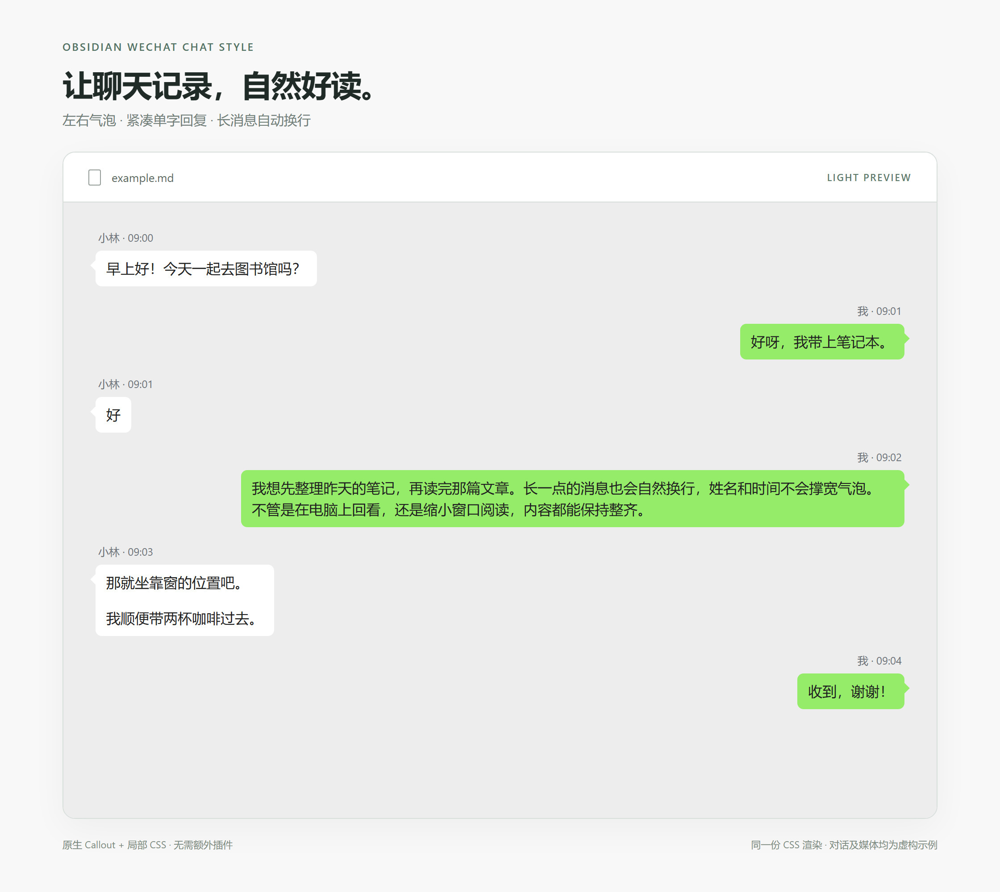
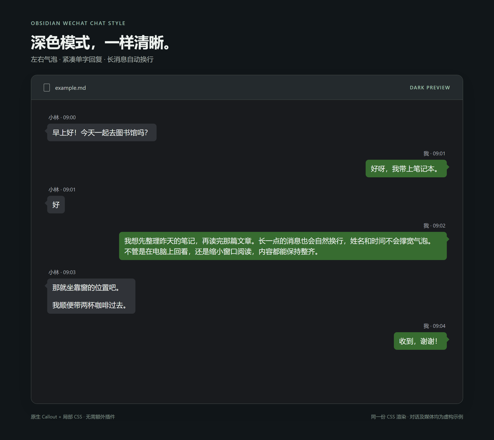
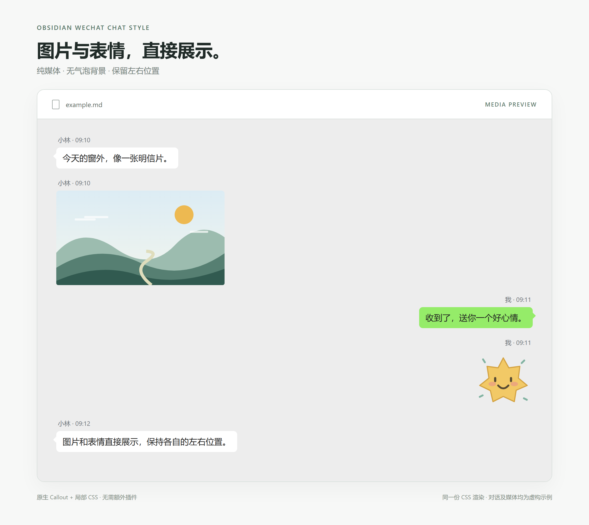

# Obsidian WeChat Chat Style

WeChat-inspired chat bubbles for Obsidian, built with native callouts and a scoped CSS snippet.

用普通 Markdown 和 Obsidian 原生 callout，把笔记显示为仿微信聊天界面。无需安装额外插件，内容仍可编辑、搜索和备份。

这是独立制作的样式片段，与微信、腾讯或 Obsidian 官方没有关联。

## 效果预览

以下展示图使用项目同一份 CSS 和原生 callout 对应的 HTML 结构渲染，展示气泡与媒体样式，并非 Obsidian 软件完整窗口截图。对话和插画均为自制虚构示例；实际界面可能随主题、字体和缩放设置略有差异。

### 浅色模式

左右气泡、紧凑的单字回复，以及长消息自动换行。



### 深色模式

同一套排版，使用适合深色背景的文字与气泡配色。



### 图片与表情

媒体保持左右位置，不添加气泡背景或尖角。



## 功能

- 对方消息靠左，自己的消息靠右。
- 浅色模式下使用白色、绿色气泡，并提供深色模式配色。
- 姓名和时间独立显示，不会把单字消息的气泡撑宽。
- 长消息自动换行，支持多段文字和普通 Markdown 内容。
- 图片、表情可以单独显示，不带气泡背景、内边距和尖角。
- 只作用于带有 `wechat-chat` 标记的笔记，不改变其他笔记和文件列表排序。
- 所有示例内容均为虚构，不包含真实聊天记录。

## 文件

```text
wechat-chat.css   样式片段
example.md        可直接放进 Obsidian 的虚构示例
README.md         使用说明
images/           三张样式预览图
```

## 安装

1. 下载 `wechat-chat.css`。请保存 CSS 文件本身，不要把 GitHub 网页另存成 HTML。
2. 打开自己的 Obsidian 仓库文件夹。仓库就是存放笔记的文件夹。
3. 将 `wechat-chat.css` 放到该仓库的 `.obsidian/snippets/` 中。没有 `snippets` 文件夹时可以新建；使用自定义配置目录的仓库，请使用相应目录下的 `snippets`。
4. 在 Obsidian 中打开“设置 → 外观 → CSS 样式代码片段”，必要时点击刷新按钮，然后启用 `wechat-chat`。
5. 将 `example.md` 放到自己的仓库中，用阅读视图打开。

也可以从 CSS 样式代码片段设置中的文件夹按钮直接打开片段目录。

第一次使用推荐阅读视图。实时预览模式也可以渲染 callout，但编辑光标位于其中时，会出现 Markdown 编辑内容；源码模式直接显示源码。

## 新建聊天笔记

在笔记最开头加入以下属性：

```yaml
---
cssclasses:
  - wechat-chat
---
```

如果笔记已经有 YAML 属性区，在原有属性区中添加 `cssclasses` 即可，不要创建第二个属性区。如果已经有其他 CSS 类，保留它们并把 `wechat-chat` 加进列表。

没有这个标记的笔记不会应用聊天样式。样式会在聊天笔记中隐藏属性面板，让阅读更简洁；需要修改属性时，可以切换到源码模式。

### 对方的消息

```markdown
> [!wechat-her] 小林 · 09:00
>
> 早上好！
```

### 自己的消息

```markdown
> [!wechat-me] 我 · 09:01
>
> 早，我已经出门了。
```

`wechat-her` 和 `wechat-me` 是固定样式标记；姓名和时间可以自由替换。不同消息块之间留一个空行。

### 多段文字

```markdown
> [!wechat-me] 我 · 09:02
>
> 这是第一段。
>
> 这是第二段。
```

### 图片和表情文件

先把自己的图片或表情文件放入仓库中，再使用实际文件名。`|media` 标记会移除气泡背景和尖角，保留左右位置、姓名和时间。

```markdown
> [!wechat-her|media] 小林 · 09:03
>
> ![[你的图片.png]]

> [!wechat-me|media] 我 · 09:04
>
> ![[你的表情.gif]]
```

上面的文件名是写法示例，仓库中不附带这些媒体。请替换为自己仓库中存在的附件文件名，或使用附件的仓库内路径。普通文字表情如 `😊` 可以直接写入文字消息。

纯媒体消息中不需要再写“图片”“动画表情”等标签。`|media` 应用于只包含媒体的消息；如果需要文字说明，可另起一条普通消息。

## 自定义颜色

用文本编辑器打开 `wechat-chat.css`，修改顶部变量，例如：

```css
.wechat-chat {
  --wechat-surface: #ededed;  /* 聊天背景 */
  --wechat-received: #ffffff; /* 对方气泡 */
  --wechat-sent: #95ec69;      /* 自己的气泡 */
  --wechat-ink: #202020;       /* 消息文字 */
  --wechat-meta: #6c7278;      /* 姓名和时间 */
}
```

深色模式颜色位于 `.theme-dark .wechat-chat` 规则中。更改后若未立即生效，可在片段设置中将 `wechat-chat` 关闭再开启。

## 适用范围与限制

- 这是显示样式，不包含微信连接、聊天读取、媒体下载或自动归档功能。
- 已在 Windows 版 Obsidian 1.15.0 的默认主题中验证核心气泡效果；其他版本、第三方主题和移动端可能需要调整。
- CSS 使用现代选择器 `:is()` 和 `:has()`，建议使用包含较新浏览器引擎的 Obsidian 版本。
- GitHub 的 Markdown 预览不会加载本片段，因此不会呈现完整聊天外观。
- 关闭 CSS 片段后，内容仍是原生 callout，不会丢失消息或附件。
- 图片清晰度、动画效果取决于附件本身；样式不会把缩略图恢复为高清原图，也不会把静态截图变成动画。
- 如果只使用文本编辑器或其他 Markdown 应用，显示效果取决于该应用对 Obsidian callout 和内部链接的支持。

## 问题反馈

反馈显示问题时，请说明 Obsidian 版本、操作系统、主题名称，以及阅读视图或实时预览模式。可以附上一小段虚构消息和截图，避免提交真实私人聊天。

## 许可证

本项目采用 MIT 许可证。许可证全文见仓库根目录的 `LICENSE` 文件。
